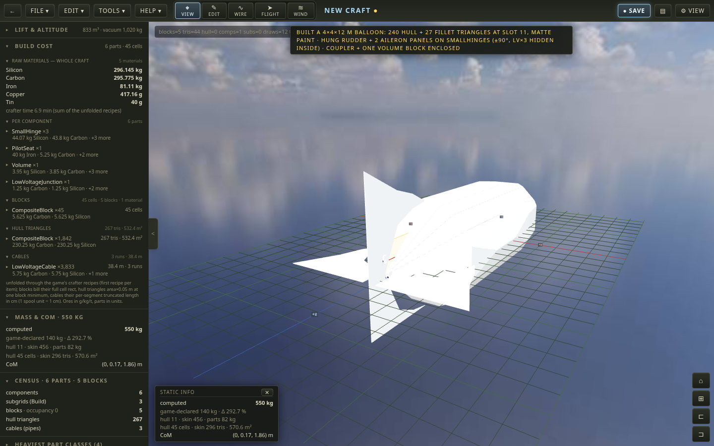
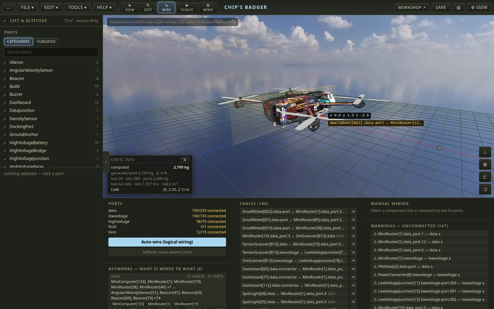
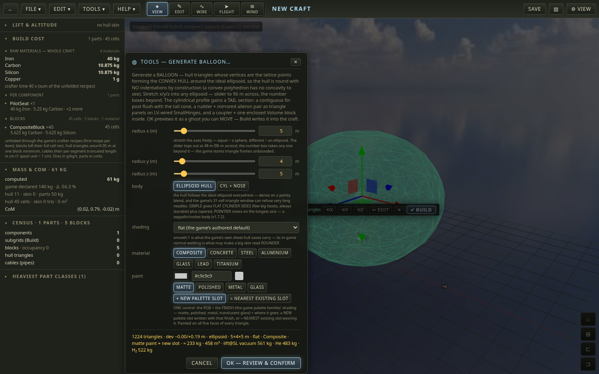
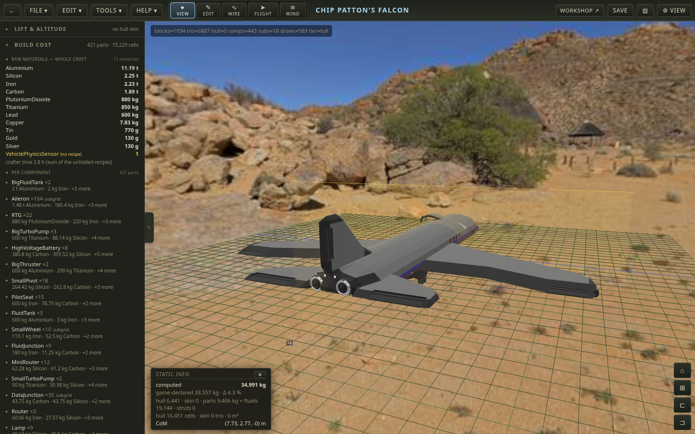
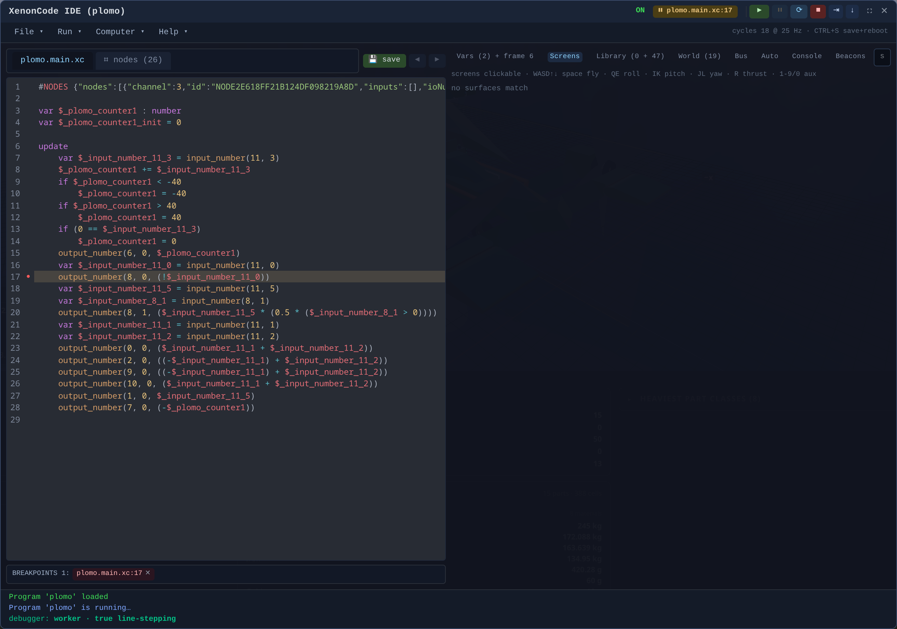
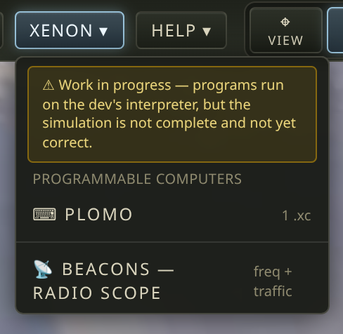

# Archean Blueprint Tools · v1.15.3

**Reverse-engineered file format + a browser editor for workshop craft of
[Archean](https://store.steampowered.com/app/2941660/Archean/)** —
the voxel/particle space-sim sandbox by batcholi / FloDKSM.



Archean stores every workshop craft as a compact `blueprint.json` — components,
voxel blocks, hull-triangle meshes, power/data/fluid wiring, nested door
subgrids. The format is undocumented; this repository reverse-engineers it
(see [FORMAT.md](FORMAT.md)) and ships the tooling that grew out of that work.

## ▶ Live site

**The Blueprint Inspector app IS the site:
https://joeppie.github.io/archean-blueprint-tools/** —
the React + TypeScript editor: craft gallery, the game's real component
meshes, live editing, generation tools, byte-exact saves. The legacy zero-build
inspector stays reachable at
**https://joeppie.github.io/archean-blueprint-tools/viewer/index.html**
(small link at the end of the gallery — it is the frozen port reference, not
the front door).

Everything outside the React app in `app/` is static — plain ES modules +
Three.js from a CDN. No build step, no npm, no server-side code (`app/` has
its own npm project; see [app/README.md](app/README.md)).

## 🕹 Two arcade cabinets you can PLAY in the browser

Some workshop crafts *are* games — XenonCode programs driving the game's
PilotSeat + Buzzer components, rendered on the craft's own screens. The
gallery's **▶ Playable** row boots them straight into the fullscreen game;
the clips below are captured INSIDE the craft (the pilot seat is in the
frame — the screen is simulated on the ship, 5 fps, 480 px).

<table>
<tr>
<th>Super Mario Brothers — Chip Patton<br>
<a href="https://joeppie.github.io/archean-blueprint-tools/?craft=3820116990&dash=first-virtual">▶ play in the browser</a>
· WASD run · SPACE jump · E fire — the title's attract mode autoplays itself</th>
<th>Space Invaders — Shadoh<br>
<a href="https://joeppie.github.io/archean-blueprint-tools/?craft=3288012440&dash=main%230">▶ play in the browser</a>
· WASD cannon · SPACE start & fire — a working Computer-driven arcade cabinet</th>
</tr>
<tr>
<td><video src="app/public/games/mario.webm" controls autoplay muted loop playsinline width="420"></video></td>
<td><video src="app/public/games/invaders.webm" controls autoplay muted loop playsinline width="420"></video></td>
</tr>
</table>

The full cockpit key set reaches the PilotSeat: WASD stick, ↑/↓, Space
(stick-up + action), F, Q/E roll, I/K pitch, J/L yaw, R thrust, 1–9/0 =
Aux 1–9/0. Opening a screen's fullscreen zoom updates the URL into exactly
the shareable deep link above.

## What the editor does

A craft opens in **View** (inspect: mass & CoM, census, the ⚖ Lift widget, the
**Build cost** readout). Five mode tiles split the workspaces —
**⌖ View · ✎ Edit · ∿ Wire · ➤ Flight · ≋ Wind**.

### The build dock — place, transform, modify (v1.11)

Editing lives in a WIDE bottom dock with ONE mode row — **+ Blocks · +
Triangles · + Parts · ✎ Modify** — plus a visible **Mirror widget**
(`⊘ x y z` glyph chips, auto-lit on mirrored crafts). Placement is
place-then-transform: a click lands a 1×1×1 cell (no size to pre-choose)
that immediately wears the widget — **✥ move · ⟳ turn · ⤢ stretch** (a
stretched face moves, its opposite stays anchored, in whole cells).
Triangles are placed as **pins**: three clicks drop lattice-corner pins
with a live preview face and a direction arrow; the pins stay draggable
after the commit, and a centroid widget moves/turns the whole prism.
**✎ Modify** starts empty and reveals the editor of whatever you pick —
a part opens **+ Parts** (inspector) by itself. The ⌖ Lift widget scores
the **sealed** envelope: block cells and skin triangles are flood-checked
from the outside, so only gas the world cannot reach counts. Colours
follow the game's day-light rig 1:1 (v1.12.1): the built-in palette,
tone map and environment are transcribed from the developer's own
viewer, so what you paint is what the game draws.

### The Wire workspace — every cable, where it goes

Chip Patton's Badger quad below sits in **Wire** mode with the hull switched to
**wireframe** (`h`) — the whole `data.pipes` graph is visible *through* the
skin, and resting the cursor on a cable prints a gold chip naming both ends
(`SmallWheel.data-port ↔ MiniRouter.data_port.3`) while the cable itself
gold-lights. The panel lists every cable as a `Type[9].port ↔ Type[0].port`
row with a ✕ that disconnects (Ctrl+Z reconnects exactly), a per-kind port
census, a NETWORKS overview ordered sources → hubs → devices, and an
auto-wire that follows the game's own port *naming* logic — inputs face
outputs, hubs feed devices, a junction's upstream input stays free for the
power source — and otherwise leaves ports honestly open instead of
force-pairing junk.



### Generate balloon — hull triangles from a shape, not a brush

**TOOLS ▸ Generate balloon…** grows a closed, convex skin of the game's hull
triangles out of the 0.25 m lattice — a convex polyhedron by construction, so
it cannot show the indentations every heuristic attempt left behind. The live
preview prints the deviation against the ideal surface, the skin mass, the
enclosed volume and sea-level lift per gas **before** anything is built; OK
drops it on the pad as a movable, cell-snapped ghost with ⟲x/⟲y/⟲z quarter-
turns, ↩ back-to-parameters and ✔ Build as one undo step (below: a 10 × 8 m
spheroid ghost with its parameter dialog dragged aside).



The cylindrical body gains a **tail section**: a fixed fin fillet clinging to
the untouched tail cone plus a rudder and a mirrored aileron pair as triangle
panels riding SmallHinge subgrids — LV cables diving into the envelope to a
coupler at the centre — the hero picture at the top, under the **sky**
backdrop. The ⚖ Lift widget scores the built envelope against the real U.S.
Standard Atmosphere 1976: lift at sea level per gas and the equilibrium
altitude.

### Look at it however the blueprint asks

Chip Patton's *Falcon* under the **desert** (Goegap) backdrop — one of the
manifest-enumerated surface panoramas (real sky above, terrain below, the
ground pad see-through). Alongside them: **orthographic projection** (key `5`)
for CAD-style parallel framing, a zoom-adaptive ground grid that fits the
build, red/blue world-axis lines with ±-labels, and the Blender-style black
coord chip that raytraces what the cursor lands on and prints the full
snapped `x y z` (file law: x lateral, **y is UP**, nose −z).



### XenonCode IDE — programs that run, and a real debugger

Craft with MiniComputers open an in-game-style IDE: the XenonCode programs run
on the dev's own interpreter compiled to WebAssembly, cycling at the game's
25 Hz cadence and wired into the craft's io bus — and the debugger is the
classical one: click a line's gutter for a breakpoint, **F10** steps lines,
**F11** steps in, **F8** resumes; the ⏸ pill names the stop site
(`plomo.main.xc:17` below), the BREAKPOINTS strip lists every break with its
code excerpt, the paused line rides a wash, and the VARS tab shows the live
locals of the frame you stopped in — editable values while paused. On
`http://localhost:PORT` (and https) the VM runs on a worker and freezes
**mid-cycle** at every stop — true line-stepping; the menu then says nothing
about it, and only warns where the browser withholds that capability
(cycle-granular stepping on plain-http LAN addresses).





### And the rest of the bench

* **Real game components** — the game's own dense meshes with your painted
  palette colours, live: every inspector field rebuilds that one part per
  frame (propellers regenerate from `data`, dashboards draw their elements).
  Hull triangles render as the closed 0.05 m prisms the game draws, on the
  exact shared lattice.
* **Edit with the mirror rule** — every edit on a selected item drives its
  mirror twin in mirrored unison (shape, paint, material, joint data, delete)
  and flags faux-mirror conflicts instead of half applying; settable mirror
  axis; block brush with ⇄ continuation; per-face paint; seven gameplay
  materials.
* **Subgrids swing with their masters** — nested door/hatch/fin content rides
  the hinge law the game's own baked benches prove (`R(q)·C·ê`, see FORMAT
  §Subgrids), gold ring/arrow handles at the captured joint line.
* **Undo/redo over everything** (Ctrl+Z keeps the camera for A/B comparing),
  occupancy/type-255 mirrors stay synced, and **Save** writes byte-exact game
  JSON — untouched fields keep their original number style.
* **Build cost** (View panel) — the whole craft unfolded through the game's
  crafter recipes to raw ores: parts, blocks, hull triangles, cables, frames
  and struts each in their own foldable group.
* **Tools ▸** also holds *Replace all…* (face colour / material batches) and
  *Blocks → hull triangles…* (face-exact hullify with the game's authoring
  defaults).
* **A validated craft cache** — every gallery craft is stored with its
  revision + SHA-256; a workshop edit after your last download is flagged on
  the card and gated by a dialog (redownload or use the cached copy — never
  silently replaced).
* **A searchable in-app manual** — Help ▸ Manual, every panel, key and tool.
* **Testing & automating XenonCode** — the IDE's Auto-test panel: a tiny
  script format (boot a probe program, run exactly N cycles, assert on the
  io bus), a `window.__XENONTEST__` door for AI agents and headless probes,
  and a Buzzer Bench fixture that proves a computer→bus→sound chain in
  seconds. See Help ▸ Manual ▸ “Testing & Automating XenonCode”.

## The legacy viewer (frozen port reference)

`viewer/index.html` is the zero-build inspector the app grew out of; it still
opens any blueprint (`?open=…`, `?real`, `?flow`, `?selftest` …) and is where
the engine semantics are pinned, but new features land in `app/` only.
Its renders — decimated/real twins, exact-lattice hull skins, linear palette
colours, merged draw calls (~150 for a 30-part fighter) — are documented in
[REWRITE.md](REWRITE.md) and the invariant list in [AGENTS.md](AGENTS.md).

## Repository map

| path | what |
|---|---|
| `app/` | the React + TypeScript editor (Vite; own npm project) — all new work |
| `app/src/engine/` | the headless scene/engine core (pure vitest pins, no React) |
| `viewer/` | the legacy zero-build inspector + frozen test suites |
| `viewer/models/` | 106 component types: geometry, mass, joints, ports, colliders — generated by `tools/extract_models.py` from an installed game |
| `testdata/` | regression corpus: 64 workshop craft + generated fixtures (117 files, 1 kB–6 MB) |
| `tools/` | format tooling: install discovery, fixture generators, matrix rituals, the release cut, the security gate |
| `tests/run_tests.sh` | headless-Chromium suite for the legacy viewer (selftest, regtest, renders) |
| `tools/release.sh` | cuts the stable release — **only ever run when the maintainer explicitly says so** |
| `FORMAT.md` | the format documentation — start here |
| `LOCATIONS.md` | how to find an Archean install, its blueprint saves and Workshop downloads on any machine |
| `AGENTS.md` | development guide for humans *and* coding agents |
| `NOTICE.md` | licensing: code GPL-3.0; game/player content belongs to its respective owners |

## Running locally

```bash
python3 -m http.server 8650          # repo root → the legacy viewer
cd app && npm install && npm run dev -- --host 0.0.0.0    # the editor (Vite)
bash tests/run_tests.sh              # legacy headless suite (python3 + chromium)
cd app && npm test                   # vitest — pure engine core
cd app && npm run test:e2e           # Playwright UI suite (desktop + phone)
```

The repo works anywhere — it does not have to live inside the Steam tree, and
no tool hardcodes a machine path. To point the tools at YOUR Archean install
(local saves and Workshop downloads), run `python3 tools/find_install.py
--conf >> blueprints.conf` — the discovery procedure behind it (Steam
`appmanifest_2941660.acf`, `Archean-data/client/blueprints/`,
`workshop/content/2941660/`) is documented in [LOCATIONS.md](LOCATIONS.md).

## Development setup

```bash
git clone https://github.com/Joeppie/archean-blueprint-tools.git
cd archean-blueprint-tools
bash tools/install-hooks.sh                               # one-per-clone: the mandatory
                                                          # checkin gate (credential-shape +
                                                          # version-string scan, headless
                                                          # selftest + regtest on viewer edits)
python3 tools/find_install.py --conf >> blueprints.conf   # optional: point at your local
                                                          # Archean install (gitignored file)
cd app && npm install && npx playwright install chromium  # the editor + its UI suite
```

`blueprints.conf` is the only place a machine-local path may live and it is
gitignored, so nothing machine-specific is ever committed (see
`blueprints.conf.example`). The contributor guide — checkin gate, test-suite
tags, versioning, release policy — is [AGENTS.md](AGENTS.md); the port status
of the rewrite is [REWRITE.md](REWRITE.md).

Useful legacy-URL parameters: `?open=<url>` open another blueprint ·
`?real` full game geometry · `?flow` particles + streamlines · `?hull` /
`?occ` toggles · `?cam=x,y,z,tx,ty,tz` camera pose · `?perf` draw-call probe ·
`?selftest`, `?proxytest` test modes. The editor deep-links with
`?craft=<workshop-id>`.

## Upstream references

The game developer (batcholi / FloDKSM) ships their own builder tools at
**[xenontools.dev](https://xenontools.dev/)**, whose **XenonViewer**
(<https://viewer.xenontools.dev/>) is this project's reference implementation
for the blueprint format — its readable sources under
<https://viewer.xenontools.dev/js/> (`scene.js`, `blueprint.js`, `palette.js`,
`blockshapes.js`) are the de-facto spec; see [NOTICE.md](NOTICE.md) §2 for the
porting terms. The official Archean wiki documents the in-game blueprint
workflow at
<https://wiki.archean.space/en/tools/BlueprintTool.html>.

## Releases

Releases are **semver `vX.Y.Z`**: `X` for an overhaul (UI, framework, scope —
`v1.0` was the app replacing the viewer), `Y` for new features, `Z` for fixes
and small tweaks. `tools/release.sh` refuses a 2-part string and a version
older than the newest tag.

GitHub Pages serves the **`release` branch** (stable); `main` is development.
A release is a `main` commit that passed the full suite, fast-forwarded onto
`release` and tagged — all done by `tools/release.sh` (see AGENTS.md §
Publishing). **Cutting a release always requires the maintainer's explicit
say-so**: green tests or merged work never imply one.

## Ideas welcome — open an issue!

This is v1.15.3: the format is decoded and the editor is useful, but the good
ideas are not all in yet. Feature requests, format questions, and craft that
render wrong (attach the `blueprint.json`) are all best filed as
[issues](https://github.com/Joeppie/archean-blueprint-tools/issues) — that is
where the roadmap lives. Already on the list:

- Better flight-characteristics analysis (360° velocity sweep, trim polar).

## Licensing (short version — see NOTICE.md)

- **Code**: GPL-3.0 (copyleft is deliberate — improvements stay open).
- **Game content** (`viewer/models/`, `testdata/`, FORMAT.md knowledge):
  belongs to the Archean developer (batcholi / FloDKSM). Player-made workshop
  craft in `testdata/` (and the craft in these screenshots) belong to their
  workshop authors. The sky backdrops are CC0 panoramas from Poly Haven —
  credits in NOTICE §2 and `app/src/assets/backdrops/`. All works belong to
  their respective owners.
- **No rights-holder permissions are claimed.** Reuse of the included
  third-party content is presumed acceptable in good faith, CC-attribution
  spirit; rights holders who disagree can raise an issue and it will be
  addressed amicably and promptly (NOTICE §4).
