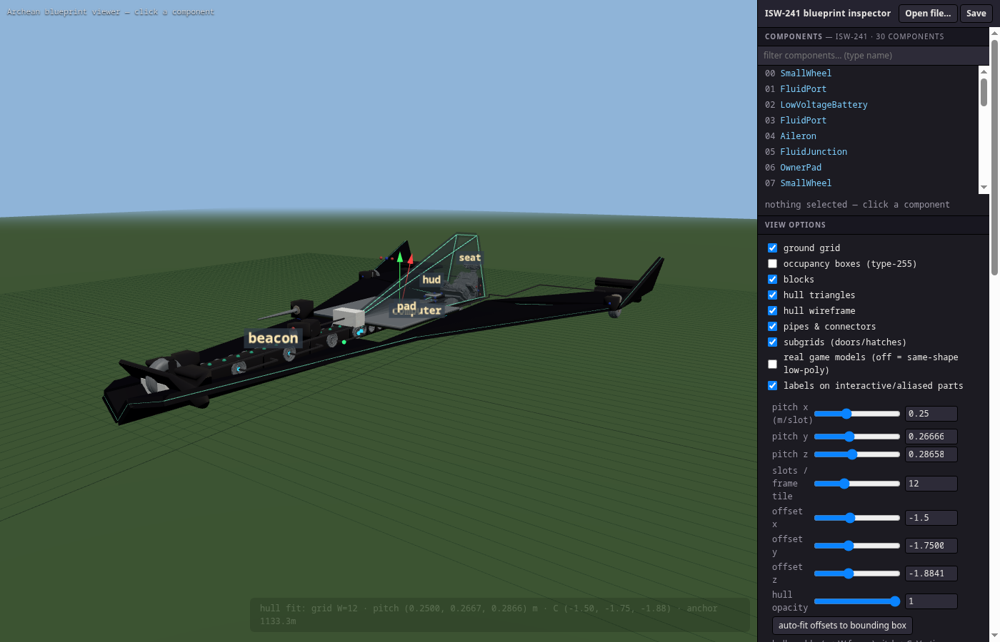

# Archean Blueprint Tools · v1.9.0

**Reverse-engineered file format + a zero-build browser viewer/inspector for
workshop craft of [Archean](https://store.steampowered.com/app/2941660/Archean/)**
— the voxel/particle space-sim sandbox by batcholi / FloDKSM.



Archean stores every workshop craft as a compact `blueprint.json` — components,
voxel blocks, hull-triangle meshes, fluid/power wiring, nested door subgrids.
The format is undocumented; this repository reverse-engineers it (see
[FORMAT.md](FORMAT.md)) and ships the tooling that grew out of that work.

Everything outside the React app in `app/` is static — plain ES modules +
Three.js from a CDN. No build step, no npm, no server-side code (`app/` has
its own npm project; see [app/README.md](app/README.md)).

## ▶ Live site

**The Blueprint Inspector app IS the site:
https://joeppie.github.io/archean-blueprint-tools/** —
the React + TypeScript editor: craft gallery, full game meshes, live editing,
byte-exact saves (also reachable as `/app/index.html`). This is the app
`viewer/` is being ported to (see [REWRITE.md](REWRITE.md)).

The legacy zero-build inspector stays reachable at
**https://joeppie.github.io/archean-blueprint-tools/viewer/index.html**
(small link at the end of the app's gallery — it is the frozen port
reference, not the front door).

Loads the ISW-241 fighter by default. Click any component to edit position,
rotation and data fields with live 3D feedback; *Open file…* (or drag-drop)
loads any `blueprint.json`, and **Save** writes it back byte-exact in the
game's own compact JSON format, keeping the block/occupancy mirror in sync.

## What the viewer shows

- **Real game components** — the game's own models (extracted from installed
  game modules) with your painted colours (`color1`/`color2`), real masses,
  joint limits (aileron ±45° hinge) and port positions. The game renders with
  raytracing, so its meshes are far denser than a raster GPU likes: the
  default view is therefore a **same-shape decimated twin** (boxes + hexagons,
  micro-detail removed), verified per-type against the real mesh by
  `?proxytest`. Tick “real game models” for the full geometry.
- **Hull skins** — hull triangles share the *exact* voxel lattice
  (`world = frame·3 − 1.5 + v·0.25`, welded shared vertices) and render as the
  closed 0.05 m prisms the game draws, with all five stored colours
  (front/back/rim). A “wireframe (hull + blocks)” overlay shows triangle and
  block edges together, in their real colours.
- **Everything else in the file** — voxel blocks in their real shapes (a block's
  `type` packs shape+orientation: cubes, slopes, corners, pyramids, inverse
  corners — the reason voxel hulls look curved) in their real **linear**
  palette colours with the game's roughness/metallicity/transparency rules,
  nested door/hatch subgrids, fluid pipes with port markers, adapter nubs,
  CoM/declared-mass cross-check, stylized thin-plate flight analysis
  (CoP/static margin, particles + streamlines — labelled *not CFD*),
  floating labels on cockpit-interactive parts (`dash`, `seat`, `button`,…
  plus in-game aliases).
- **Built for weak GPUs** — blocks/pipes/streamlines/ports each merged into
  single draw calls, on-demand rendering (idle = GPU asleep), clamped pixel
  ratio. ~150 draw calls for a 30-component fighter.

## Repository map

| path | what |
|---|---|
| `viewer/` | the 3D inspector/editor (one ES module + hullfit + palette + lazy model atlas) |
| `viewer/models/` | 106 component types: geometry (full + low-poly), mass, joints, ports, colliders — generated by `tools/extract_models.py` from an installed game |
| `regtest/` | format-validation suite over the whole `testdata/` corpus (auto-discovers craft) |
| `testdata/` | 25 workshop blueprints (1 kB–2.5 MB, incl. the Classic American Semi Truck) used as regression corpus |
| `tools/extract_models.py` | regenerates `viewer/models/` from a local Archean install |
| `tools/find_install.py` | finds the local Archean install / blueprint saves / Workshop dir on any machine (see `LOCATIONS.md`) |
| `tools/adjust_seat.py` | example of a safe scripted format edit |
| `tests/run_tests.sh` | headless-Chromium suite: selftest, regtest, proxytest, render shots |
| `tools/release.sh` | cuts the stable release onto the `release` branch — **only ever run when the maintainer explicitly says so** |
| `FORMAT.md` | the format documentation — start here |
| `LOCATIONS.md` | how to reliably find an Archean install, its local blueprint saves and Workshop downloads on any machine |
| `AGENTS.md` | development guide for humans *and* coding agents |
| `NOTICE.md` | licensing: code GPL-3.0; game/player content belongs to its respective owners |

## Running locally

```bash
python3 -m http.server 8650          # repo root
# viewer:  http://127.0.0.1:8650/viewer/index.html
# suite:   tests/run_tests.sh        (python3 + chromium; exit 0 = all green)
```

The repo works anywhere — it does not have to live inside the Steam tree, and
no tool hardcodes a machine path. To point the tools at YOUR Archean install
(local saves and Workshop downloads), run `python3 tools/find_install.py
--conf >> blueprints.conf` — the discovery procedure behind it (Steam
`appmanifest_2941660.acf`, `Archean-data/client/blueprints/`,
`workshop/content/2941660/`) is documented in [LOCATIONS.md](LOCATIONS.md).

## Development setup

```bash
git clone https://github.com/Joeppie/archean-blueprint-tools.git ~/archean-blueprint-tools
cd ~/archean-blueprint-tools
bash tools/install-hooks.sh                               # one-per-clone: the mandatory
                                                          # checkin gate (credential-shape +
                                                          # version-string scan, headless
                                                          # selftest + regtest on viewer edits)
python3 tools/find_install.py --conf >> blueprints.conf   # optional: point at your local
                                                          # Archean install (gitignored file)
cd app && npm install                                     # only for the React app/ rewrite
```

Clone over HTTPS as above, or use the SSH URL
(`git@github.com:Joeppie/archean-blueprint-tools.git`) if you have a key on the
repo. Everything outside `app/` is zero-build — Python 3 + Chromium for the
test suite, no other dependencies. `blueprints.conf` is the only place a
machine-local path may live and it is gitignored, so nothing machine-specific
is ever committed (see `blueprints.conf.example`). The React rewrite in `app/`
is its own npm project (`npm test` = vitest, `npm run test:e2e` = Playwright,
`npm run dev`); its phase plan and the current `viewer/` → `app/` porting
status are in [REWRITE.md](REWRITE.md), and the full contributor guide —
checkin gate, test suites, release policy — is [AGENTS.md](AGENTS.md).

Useful URL parameters: `?open=<url>` open another blueprint ·
`?real` full game geometry · `?flow` particles + streamlines ·
`?hull` / `?occ` toggles · `?cam=x,y,z,tx,ty,tz` camera pose ·
`?perf` draw-call probe in the tab title · `?selftest`, `?proxytest` test modes.

## Upstream references

The game developer (batcholi / FloDKSM) ships their own builder tools at
**[xenontools.dev](https://xenontools.dev/)**, whose **XenonViewer**
(<https://viewer.xenontools.dev/>) is this project's reference implementation
for the blueprint format — its readable sources under
<https://viewer.xenontools.dev/js/> (`scene.js`, `blueprint.js`, `palette.js`,
`blockshapes.js`) are the de-facto spec; see [NOTICE.md](NOTICE.md) §2 for the
porting terms. The official Archean wiki documents the in-game blueprint
workflow at
<https://wiki.archean.space/en/tools/BlueprintTool.html>.

## Releases

Releases are **semver `vX.Y.Z`**: `X` for an overhaul (UI, framework, scope —
`v1.0` was the app replacing the viewer), `Y` for new features, `Z` for fixes
and small tweaks. `tools/release.sh` refuses a 2-part string and a version
older than the newest tag.

GitHub Pages serves the **`release` branch** (stable); `main` is development.
A release is a `main` commit that passed the full suite, fast-forwarded onto
`release` and tagged — all done by `tools/release.sh` (see AGENTS.md §
Publishing). **Cutting a release always requires the maintainer's explicit
say-so**: green tests or merged work never imply one.

## Ideas welcome — open an issue!

This is v1.9.0: the format is decoded and the viewer is useful, but the good
ideas are not all in yet. Feature requests, format questions, and craft that
render wrong (attach the `blueprint.json`) are all best filed as
[issues](https://github.com/Joeppie/archean-blueprint-tools/issues) — that is
where the roadmap lives. Already on the list:

- Better flight-characteristics analysis (360° velocity sweep, trim polar).

## Licensing (short version — see NOTICE.md)

- **Code**: GPL-3.0 (copyleft is deliberate — improvements stay open).
- **Game content** (`viewer/models/`, `testdata/`, FORMAT.md knowledge):
  belongs to the Archean developer (batcholi / FloDKSM). Player-made workshop
  craft in `testdata/` belong to their workshop authors. All works belong to
  their respective owners.
- **No rights-holder permissions are claimed.** Reuse of the included
  third-party content is presumed acceptable in good faith, CC-attribution
  spirit; rights holders who disagree can raise an issue and it will be
  addressed amicably and promptly (NOTICE §4).
